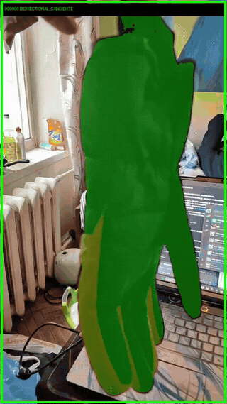
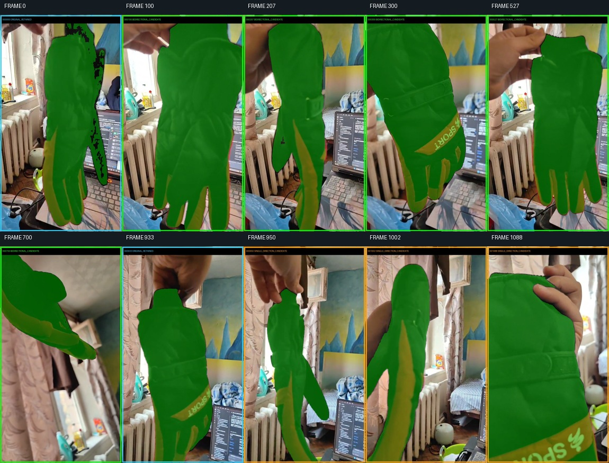
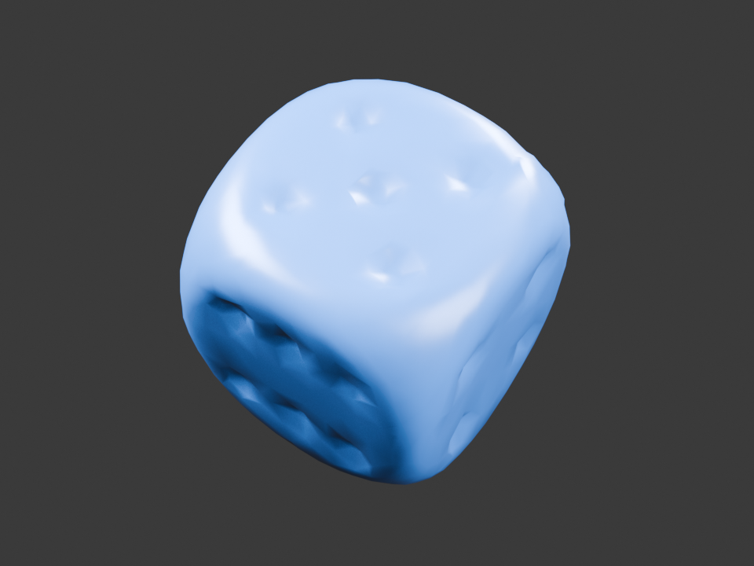
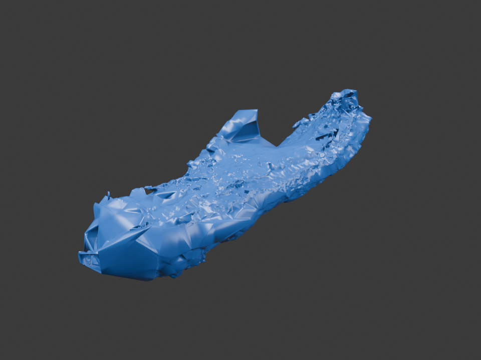

# Kozlov Vision Reconstruction

**基于多视图几何、SAM3 与 Kozlov 视觉理论的三维重建研究平台**

Kozlov Vision Reconstruction 将两个相关但独立验收的方向放在同一仓库中：

1. **对象三维重建工程线**：照片或视频输入，经过对象掩膜、相机恢复、稀疏/稠密几何、边界审查，输出浏览器报告、Blender 文件或 CAD/STEP。
2. **Kozlov 数学研究线**：把 В. Н. Козлов 关于有限点集、仿射不变量、图像代码、对应关系和视觉形象的构造转化为可执行算法、精确证书与反例测试。

两条路线共享输入身份、证据记录和可视化基础设施，但不会把成熟的 SfM/MVS 工程结果冒充为论文算法证明，也不会把数学等价判定冒充为通用语义分割。

## 实际效果

### 视频对象掩膜

[](docs/media/glove-mask-demo.mp4)

上图来自真实手套视频的对象掩膜与时序融合结果。**点击动画可打开压缩后的完整 MP4 演示。** 下图按原视频时间顺序展示了不同角度、遮挡和快速运动下的关键帧：



### 生成的三维模型

| 闭合骰子模型（Blender/CAD 示例） | 手套实验表面（开放且仍较粗糙） |
|---|---|
|  |  |

可直接下载和检查真实生成文件：

- 骰子：[Blender](docs/media/dice-model.blend) · [PLY](docs/media/dice-model.ply) · [FreeCAD](docs/media/dice-model.FCStd) · [STEP](docs/media/dice-model.step)
- 手套实验表面：[Blender](docs/media/glove-model.blend) · [PLY](docs/media/glove-model.ply)

骰子文件来自同一份简化后网格，适合演示 Blender 与 CAD/STEP 交付。手套模型用于展示当前视频重建的真实状态，仍能看到局部稀疏、粗糙和边界错误，因此不标作闭合 CAD。媒体来源与范围见 [`docs/media/README.md`](docs/media/README.md)。

## 样例：点阵与点位追踪

**三维点阵（point cloud）预览**——直接从上面两份 PLY 抽点渲染，不做任何表面重建，方便看清点密度和空洞：

| 骰子点阵（1002 点） | 手套点阵（63710 点） |
|---|---|
|  |  |

点云原文件：[dice-model.ply](docs/media/dice-model.ply) · [glove-model.ply](docs/media/glove-model.ply)

**点位追踪交互报告**——来自 `PPP_VIDEO` 的真实增量追踪证据，可直接在浏览器里拖时间轴看每一帧的候选点、相邻帧光流边和跨帧重识别：

- [打开追踪报告](docs/samples/tracks_demo_index.html)（2 MB 单文件，离线可看）
- 统计：[`tracks_demo_result.json`](docs/samples/tracks_demo_result.json)

该样例的规模：192 帧、14626 条候选轨迹、43488 次观测、28862 条相邻帧光流边；其中 5225 个点获得支持、992 个为暂定点、1579 个面、4 个独立连通分量。注意报告里 `quality_status` 是 `NOT_EVALUATED`、`independently_verified_physical_point_ids` 是 0，也就是说这些是**候选追踪**，不是经过物理验证的同一点身份，不能当作精度结论引用。

## 主要能力

- 照片目录或视频的一键任务入口（Windows PowerShell）。
- SAM3 对象掩膜、本地权重绑定、候选选择、资源监督与逐帧状态记录。
- COLMAP/pycolmap 相机恢复、特征匹配、稀疏模型和模型回读。
- OpenMVS 场景桥接、对象掩膜消费、深度/表面生成与边界诊断。
- 针对窄缝、边缘跨越、错误粘连、遮挡和局部点密度的自动审查模块。
- PLY/网格浏览器、Blender 自动导出与独立回读。
- 闭合网格到 FreeCAD/STEP 的转换、来源绑定和可选参考长度定尺度。
- Kozlov 1996/2002/2009/2025 相关有限点算法、精确有理数构造和独立验证器。
- Streamlit 交互界面、机器可读 JSON 状态和可复现测试。

## 处理流程

```text
照片目录 / 视频
        │
        ▼
输入规范化与抽帧 ──► SAM3 对象掩膜 ──► 掩膜时序/边界审查
        │                                      │
        └──────────────────┬───────────────────┘
                           ▼
                 SfM 相机与稀疏点恢复
                           ▼
              对象内点、对应和覆盖范围审查
                           ▼
                  MVS 深度与局部/整体表面
                           ▼
          HTML 查看器 / Blender / FreeCAD / STEP

Kozlov 精确研究模块作为独立研究路线读取有限点和对应数据，
输出构造结果、仿射证书、退化分类和反例，而不是替换相机标定。
```

## 当前状态

| 模块 | 状态 | 说明 |
|---|---|---|
| 输入整理与视频抽帧 | 已实现 | 保留文件身份、帧序号、时间戳和方向信息 |
| SAM3 对象分割 | 已实现 | 支持本地模型与有界 worker；单帧可为 `NO_MATCH` |
| SfM 稀疏重建 | 已实现 | 真实任务可得到完整、局部或多个分量 |
| 掩膜与边界审查 | 已实现 | 包含时序关联、窄缝、跨边界面片和点密度检查 |
| MVS/局部表面 | 已实现 | 表面质量取决于视角、掩膜和已注册几何 |
| Blender 导出 | 已实现 | 由独立 Blender 进程回读核验 |
| FreeCAD/STEP | 已实现 | 仅对满足闭合与拓扑要求的网格发布；无参考长度时为任意尺度 |
| Kozlov 有限点研究 | 已实现多个精确域 | 适用域、退化情形和工程扩展分别记录 |

任务状态不会只用一个“成功”覆盖全部阶段。常见状态包括 `SUCCESS`、`PARTIAL`、`NO_MATCH`、`NO_MODEL`、`RESOURCE_LIMIT`、`NOT_EVALUATED` 和 `INVALID_MESH_TOPOLOGY`。

## 快速开始

### 1. 克隆与基础环境

```powershell
git clone https://github.com/Avp0peT/kozlov-vision-reconstruction.git
Set-Location .\kozlov-vision-reconstruction

py -3.13 -m venv .venv
.\.venv\Scripts\Activate.ps1
python -m pip install --upgrade pip
python -m pip install -e ".[dev,app,io]"
```

SAM3、COLMAP/OpenMVS、Blender 和 FreeCAD 属于外部运行环境，不会由基础安装静默下载。SAM3 的隔离环境与固定版本见 [`integrations/sam3/README.md`](integrations/sam3/README.md) 和 [`integrations/sam3/VERSIONS.json`](integrations/sam3/VERSIONS.json)。

### 2. 先检查计划

```powershell
.\scripts\run_photo_demo.ps1 `
  -Source '<path-to-video-or-photo-folder>' `
  -Prompt 'target object' `
  -Frames 24 `
  -Target blender `
  -PlanOnly
```

`-PlanOnly` 只检查输入、依赖、预算和阶段计划，不运行模型。

### 3. 视频或照片生成 Blender 结果

```powershell
# 视频
.\scripts\run_photo_demo.ps1 `
  -Source '<path-to-video>' `
  -Prompt 'glove' `
  -Frames 24 `
  -Target blender `
  -Output '.\outputs\photo_demo\glove01'

# 照片目录
.\scripts\run_photo_demo.ps1 `
  -Source '<path-to-photo-folder>' `
  -Prompt 'object' `
  -Target blender `
  -Output '.\outputs\photo_demo\object01'
```

### 4. 继续生成 CAD/STEP

```powershell
.\scripts\run_photo_demo.ps1 `
  -Source '<path-to-photo-folder>' `
  -Prompt 'object' `
  -Target cad `
  -FreecadPython '<path-to-FreeCAD-python.exe>' `
  -Output '.\outputs\photo_demo\object_cad01'
```

### 5. 查询任务或重建报告

```powershell
python -B -X utf8 .\scripts\run_photo_demo.py status `
  --run '.\outputs\photo_demo\glove01'

python -B -X utf8 .\scripts\run_photo_demo.py report `
  --run '.\outputs\photo_demo\glove01'
```

主要结果：

- `<run>/pipeline.json`：机器可读阶段状态。
- `<run>/report/index.html`：逐阶段浏览器报告。
- `<run>/artifacts/`：点云、网格、Blender 或 CAD 产物（取决于已完成阶段）。

退出码：`0` 完成所选目标；`1` 保留部分成果；`2` 输入错误；`3` 前置环境不可用；`4` 后端/证据/收尾错误；`5` 资源限制；`130` 用户取消。

完整参数见 [`docs/PHOTO_DEMO_USAGE.md`](docs/PHOTO_DEMO_USAGE.md)。

## 交互界面

```powershell
python -m streamlit run app/Home.py
```

界面覆盖有限点集、仿射变换、图像代码、识别、压缩、立体视觉、Blender 导出、照片到三维和精确研究入口。数学逻辑位于 `src/`，界面只负责输入、调用和展示。

## Python 示例

```python
from kozlov_lab import AffineFrame, AffineTransform, PointSet2D

points = PointSet2D.load("examples/square_3x.json")
transform = AffineTransform.shear(0.8, 0.0)
moved = transform.apply_set(points)

frame = AffineFrame.auto(points.as_array())
before = frame.coordinates_batch(points.as_array())
after = frame.transformed(transform).coordinates_batch(moved.as_array())

print(abs(after["alpha"] - before["alpha"]).max())
print(abs(after["beta"] - before["beta"]).max())
```

## 测试

```powershell
# 基础数学与精确构造
python -m pytest -q `
  tests/test_affine_frame.py `
  tests/test_kozlov_recognition.py `
  tests/test_parallel_construction.py

# 全套测试（需要相应可选依赖和本地工具）
python -m pytest -q
```

测试结果必须与原生程序执行、真实模型推理、产物回读和人工质量检查分开解释。

## 仓库结构

```text
kozlov-vision-reconstruction/
├── src/kozlov_lab/          数学核心、图像代码、识别、压缩与立体视觉
├── integrations/            SAM3、视频、MVS、Blender、CAD 和演示流水线
├── scripts/                 CLI、一键入口、检查与导出工具
├── app/                     Streamlit 交互界面
├── tests/                   单元、契约、反例和流程测试
├── experiments/             可执行研究实验
├── examples/                小型输入示例
└── docs/                    使用说明、契约、理论映射和来源登记
```

`data/`、`outputs/`、模型权重、虚拟环境、第三方源码 checkout 和本机缓存不进入 Git。它们必须由使用者按文档在本地准备。

## 关键文档

| 主题 | 文档 |
|---|---|
| 一键照片/视频流程 | [`docs/PHOTO_DEMO_USAGE.md`](docs/PHOTO_DEMO_USAGE.md) |
| 项目模块与完成清单 | [`docs/PROJECT_COMPLETION_CHECKLIST.md`](docs/PROJECT_COMPLETION_CHECKLIST.md) |
| SAM3 接入与边界 | [`docs/SAM3_USAGE.md`](docs/SAM3_USAGE.md) |
| OpenMVS 表面流程 | [`docs/MVS_SURFACE_USAGE.md`](docs/MVS_SURFACE_USAGE.md) |
| Blender 导出 | [`docs/BLENDER_EXPORT_USAGE.md`](docs/BLENDER_EXPORT_USAGE.md) |
| 网格到 CAD | [`docs/MESH_TO_CAD_USAGE.md`](docs/MESH_TO_CAD_USAGE.md) |
| 已对应平行投影构造 | [`docs/LABELLED_STEREO_USAGE.md`](docs/LABELLED_STEREO_USAGE.md) |
| 论文算法到代码映射 | [`docs/KOZLOV_PAPER_IMPLEMENTATION_MAP.md`](docs/KOZLOV_PAPER_IMPLEMENTATION_MAP.md) |
| 一手来源登记 | [`docs/sources/SOURCES.md`](docs/sources/SOURCES.md) |
| 数据与接口契约 | [`docs/contracts.md`](docs/contracts.md) |

## 学术来源与外部项目

Kozlov 研究模块以 [`docs/sources/SOURCES.md`](docs/sources/SOURCES.md) 为统一来源登记，主要包括：

- В. Н. Козлов，*Математическое моделирование зрительного восприятия*，1996。
- В. Н. Козлов，*Об одном подходе к сжатию информации при обработке и распознавании изображений*，2002。
- В. Н. Козлов，*Распознавание изображений, представляемых конечным множеством точек*，2009。
- В. Н. Козлов，*О трех начальных приближениях к формальному определению визуального образа в произвольной визуальной среде*，2025。

工程路线使用或适配以下开源项目：

- [SAM 3](https://github.com/facebookresearch/sam3)：对象分割与提示式掩膜。
- [COLMAP](https://github.com/colmap/colmap) / [pycolmap](https://github.com/colmap/pycolmap)：相机恢复与稀疏重建。
- [OpenMVS](https://github.com/cdcseacave/openMVS)：稠密深度与表面重建。
- [Blender](https://www.blender.org/)：三维查看、打包与 `.blend` 输出。
- [FreeCAD](https://www.freecad.org/)：网格到实体及 STEP 输出。

各项目拥有各自许可证与模型使用条件；本仓库不会重新分发 SAM3 权重、第三方安装环境或原始论文 PDF。

## 设计原则

- **对象身份可追溯**：输入、帧、掩膜、相机、点、网格和导出文件均保留绑定。
- **边界优先**：指缝、窄缝和物体外轮廓不能仅凭三个顶点在掩膜内就跨越成面。
- **部分结果可保留**：视角不足时保留可建模区域，不把孔洞自动伪装成观测表面。
- **精确层与数值层分离**：数学定义使用精确表示；浮点容差属于工程策略。
- **证据分层**：测试通过、模型运行、文件生成、原生回读、几何有效和外形验收是不同结论。

## 项目元数据

- Python 包名：`kozlov-lab`（为兼容现有代码保留）。
- Python：3.12 及以上；主要开发环境为 Python 3.13。
- 基础依赖：NumPy。
- 可选依赖：pytest、Hypothesis、Streamlit、Plotly、Matplotlib、Pillow。
- 仓库默认不包含许可证文件；使用、分发或二次授权前请先与仓库所有者确认。
